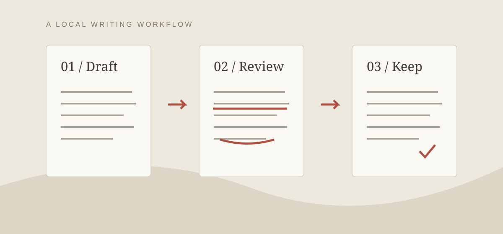

<!-- block:title -->
# A calm home for your articles

<!-- block:intro -->
A useful writing system can be simple. Let your AI write the draft, save it in a local folder, and give yourself a quiet place to read it carefully.

<!-- block:workflow-image -->

<!-- block:one-place -->
## Keep one place for each kind of writing

<!-- block:folders -->
Use a folder for everyday drafts and another for a planned series. Each article can keep its own images and translation beside the original. You always know which files belong together.

<!-- block:review -->
## Read first. Ask for one clear change.

<!-- block:revision -->
If a paragraph feels vague, copy it into your AI conversation with a specific request: “Add a concrete example and explain the next step.” Save the revision back to the same file, then return here to review it.

<!-- block:archive -->
## Publish when you are ready

<!-- block:keep -->
After you approve the article, publish it with your usual tools. Keep the local original, its images and your review notes together, so the next revision starts from a reliable place.

