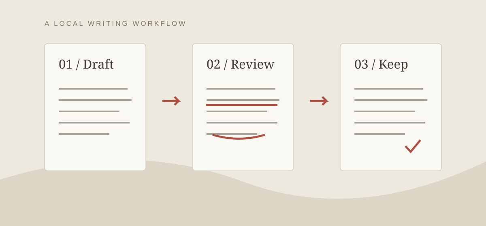

<!-- block:title -->
# 给文章一个安静的家

<!-- block:intro -->
顺手的写作方式可以很简单：让 AI 起草，把文章存进本地文件夹，再留一个安静的地方，认真读一遍。

<!-- block:workflow-image -->

<!-- block:one-place -->
## 每一类文章，都有自己的位置

<!-- block:folders -->
日常草稿放一个文件夹，计划连载的系列放另一个。每篇文章的图片和译文就放在原稿旁边，哪些文件属于哪一篇，一眼就能找到。

<!-- block:review -->
## 先读，再提出一个具体修改

<!-- block:revision -->
如果某段写得不够清楚，就复制到 AI 对话里，提出明确要求：“加一个实际例子，并说清下一步怎么做。”让修改保存回原文件，再回到这里复核。

<!-- block:archive -->
## 满意后再发布，原稿留在本地

<!-- block:keep -->
文章确认后，继续用自己熟悉的工具发布。本地保留原文、素材图和审阅记录，下次修改就能从可靠的版本继续。

